<p align="center">
  <a href="README.md">English</a> · <a href="README.pt-BR.md">Português (Brasil)</a> · <b>Español</b> · <a href="README.zh-CN.md">简体中文</a> · <a href="README.ja.md">日本語</a>
</p>

<p align="center">
  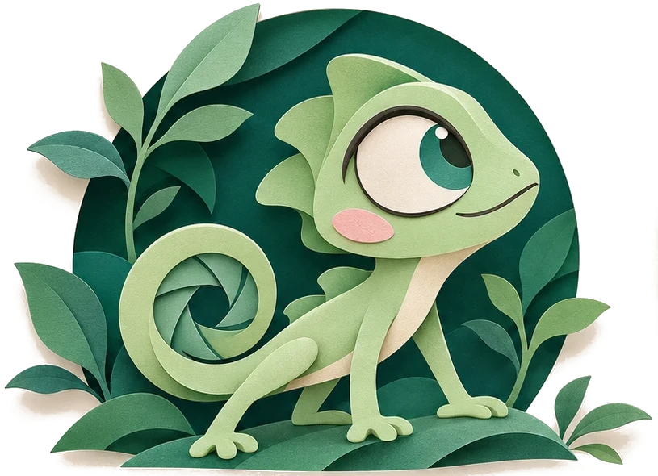
</p>

<h1 align="center">Kamo</h1>

<p align="center">
  <b>Dale a grabar. Haz clic. Detén. Ya está editado.</b><br>
  Un grabador de pantalla gratis y de código abierto que hace zoom en cada clic, suaviza tu cursor<br>
  y exporta un video que parece que alguien pasó una hora editándolo. Tú no pasaste ni un minuto.
</p>

<p align="center">
  <a href="LICENSE"></a>
  <a href="https://github.com/dssiqueira/kamo/actions/workflows/ci.yml"></a>
  
  
</p>

<h3 align="center">Ya disponible para Windows</h3>

<p align="center">
  <a href="https://github.com/dssiqueira/kamo/releases/latest"></a>
  
  
</p>

<p align="center">
  <sub>Cuando salga la extensión para Chrome, también funcionará en Edge, Brave y Arc. ¿No puedes esperar? <a href="#compilar-desde-el-código">Compílala desde el código</a>.</sub>
</p>

<p align="center">
  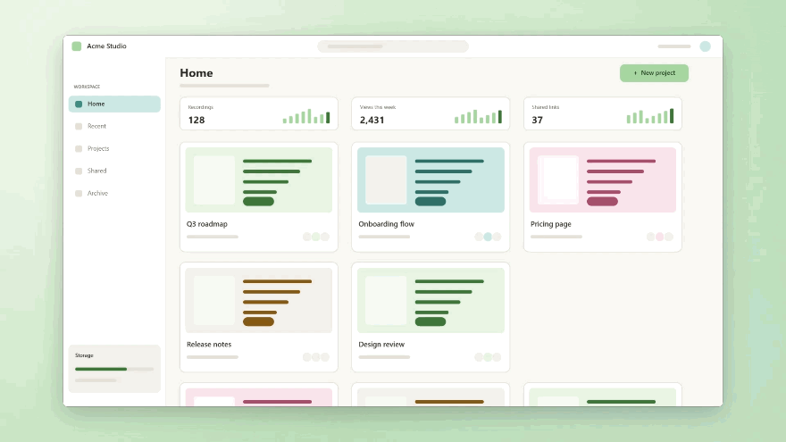
</p>

> [!NOTE]
> **Kamo es joven.** La versión para Windows ya está aquí, y es en Windows donde Kamo se desarrolla y se prueba todos los días. La app para Mac y la extensión para Chrome llegan muy pronto. Los instaladores todavía no tienen firma de código. Las versiones se publican en [GitHub Releases](https://github.com/dssiqueira/kamo/releases); si te topas con algo que no va fino, [abre un issue](https://github.com/dssiqueira/kamo/issues).

> [!TIP]
> **Primer arranque en Windows.** Como el instalador todavía no tiene firma de código, SmartScreen puede mostrar "Windows protegió su PC". Haz clic en **Más información** y luego en **Ejecutar de todas formas**.

---

## Qué lo hace diferente

**Tú no editas. Tú grabas.** Kamo se fija en dónde haces clic (solo el ratón, nunca el teclado) y, cuando detienes la grabación, el video ya tiene una cámara que sigue la acción, un cursor que se desliza en lugar de temblar y un encuadre que parece diseñado.

<p align="center">
  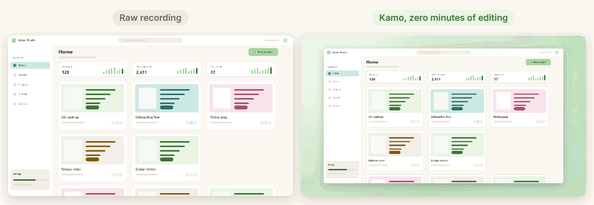
</p>

<table>
  <tr>
    <td width="50%" valign="top"><b>Los clics se convierten en zooms.</b> Los clics cercanos comparten un mismo plano, así que la cámara nunca va dando saltos. Cada movimiento es un resorte (rigidez 170, amortiguación 26), nunca un desplazamiento lineal.</td>
    <td width="50%" valign="top"><b>Un cursor que se desliza.</b> Kamo deja fuera de la grabación el cursor del sistema y lo vuelve a dibujar a partir del recorrido de tu ratón, con el mismo resorte. Más grande, más suave y con una onda en cada clic.</td>
  </tr>
  <tr>
    <td width="50%" valign="top"><b>Fondo, margen, esquinas y sombra</b> vienen activados de serie. Elige un fondo prediseñado, un color sólido o tu propia imagen.</td>
    <td width="50%" valign="top"><b>Todo se puede editar.</b> Arrastra, estira o borra zooms en la línea de tiempo y recorta los extremos. Tus zooms manuales nunca se sobrescriben cuando los zooms se vuelven a generar.</td>
  </tr>
</table>

### Una grabación, todos los formatos

16:9 para YouTube, 1:1 para el feed, 9:16 para Reels y Shorts, exportados juntos desde la misma línea de tiempo. MP4 hasta 4K60, GIF y subtítulos en `.srt`. La vista previa y la exportación comparten el mismo código de renderizado: lo que ves es lo que obtienes. Sin marca de agua, sin límite de tiempo.

<p align="center">
  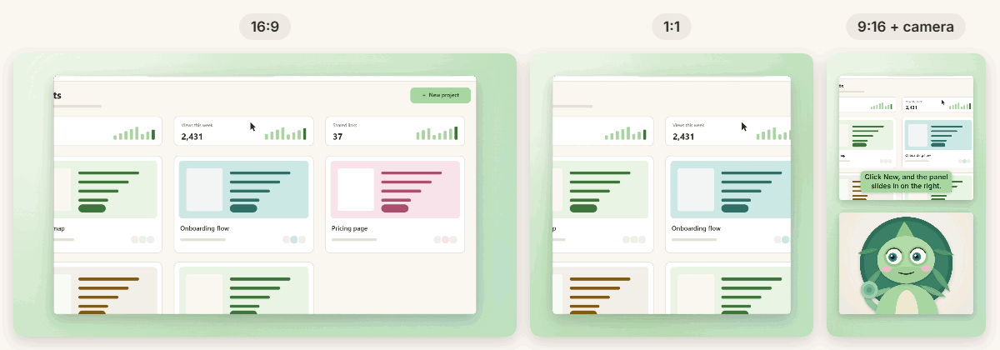
</p>

<table>
  <tr>
    <td width="50%" valign="top">
      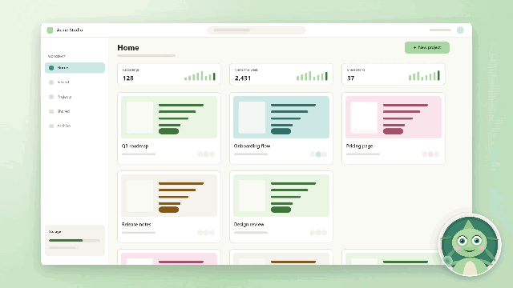
      <br><b>Burbuja de cámara web.</b> Redonda, cuadrada o panorámica, en cualquier esquina o donde la arrastres. Se encoge mientras la cámara hace zoom y vuelve después. En 9:16 puede convertirse en su propia tarjeta (dividido).
    </td>
    <td width="50%" valign="top">
      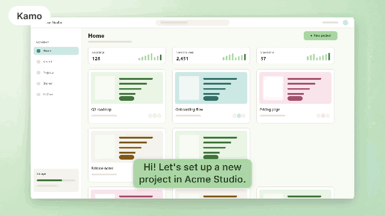
      <br><b>Subtítulos en 12 estilos.</b> Transcritos en tu equipo (con un paquete opcional que solo descargas si lo quieres). Corrige una palabra en la línea de tiempo y la transcripción se actualiza. Incrústalos en el video o exporta un <code>.srt</code>.
    </td>
  </tr>
  <tr>
    <td width="50%" valign="top">
      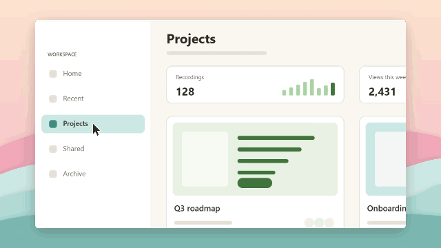
      <br><b>Tu propio fondo.</b> Suelta un PNG, JPG o WebP. Kamo lo copia al proyecto y lo recorta para que encaje en cada formato.
    </td>
    <td width="50%" valign="top">
      <picture>
        <source media="(prefers-color-scheme: dark)" srcset="docs/readme/caption-styles-dark.webp">
        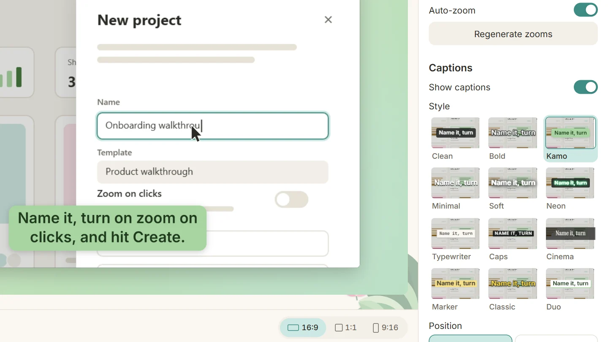
      </picture>
      <br><b>Elige un estilo, no una fuente.</b> Limpio, Marcado, Kamo, Neón, Teletipo, Cine y seis más, abajo o en el centro, en tres tamaños. Un clic y la vista previa se actualiza.
    </td>
  </tr>
</table>

<sub>Todos los clips de esta página son de una app de demostración inventada, editados y exportados por Kamo y luego convertidos en GIF para GitHub. La "cámara web" es un camaleón ilustrado dibujado en un canvas. Ninguna pantalla ni cara real sufrió daños.</sub>

## Cómo funciona

<picture>
  <source media="(prefers-color-scheme: dark)" srcset="docs/readme/how-it-works-dark.svg">
  
</picture>

## Un recorrido por la app

<table>
  <tr>
    <td width="50%" valign="top">
      <picture>
        <source media="(prefers-color-scheme: dark)" srcset="docs/readme/home-dark.webp">
        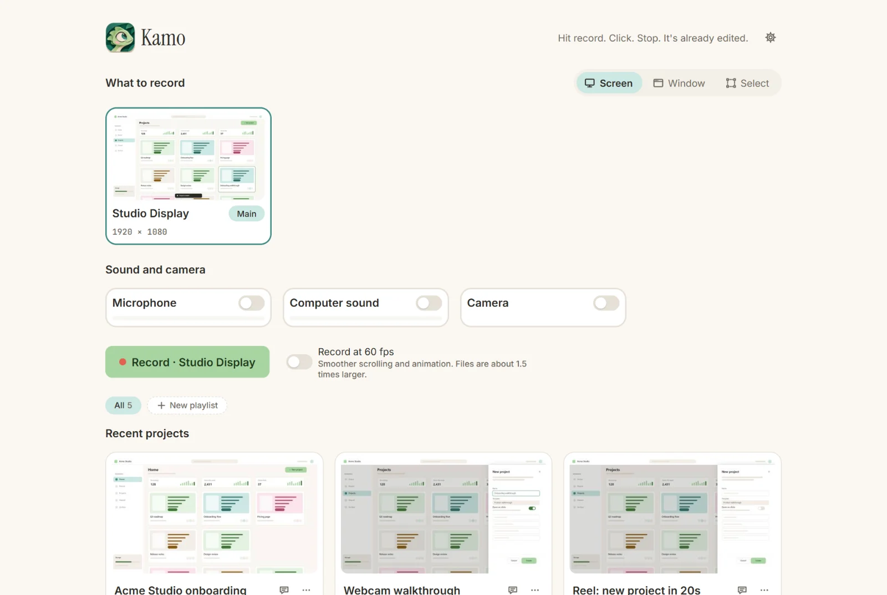
      </picture>
      <br><b>Inicio.</b> Pantalla, Ventana o Seleccionar. Micrófono, sonido del equipo y cámara se activan con un solo interruptor cada uno. Tus proyectos y playlists locales están justo debajo.
    </td>
    <td width="50%" valign="top">
      <picture>
        <source media="(prefers-color-scheme: dark)" srcset="docs/readme/editor-dark.webp">
        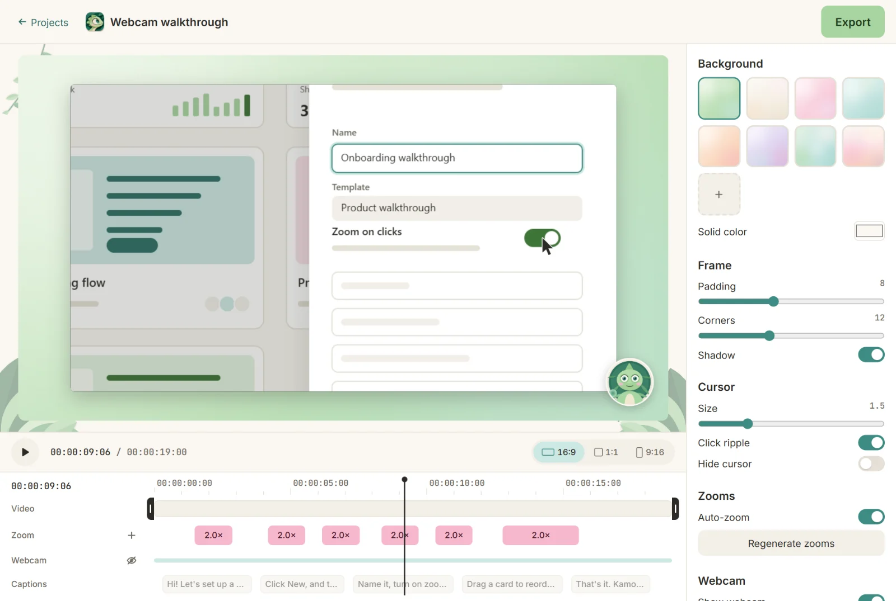
      </picture>
      <br><b>Editor.</b> Vista previa en vivo en el centro, estilo a la derecha, y zooms, cámara web y subtítulos en la línea de tiempo. La edición no es destructiva: el video original nunca se toca.
    </td>
  </tr>
  <tr>
    <td width="50%" valign="top">
      <picture>
        <source media="(prefers-color-scheme: dark)" srcset="docs/readme/select-frame-dark.webp">
        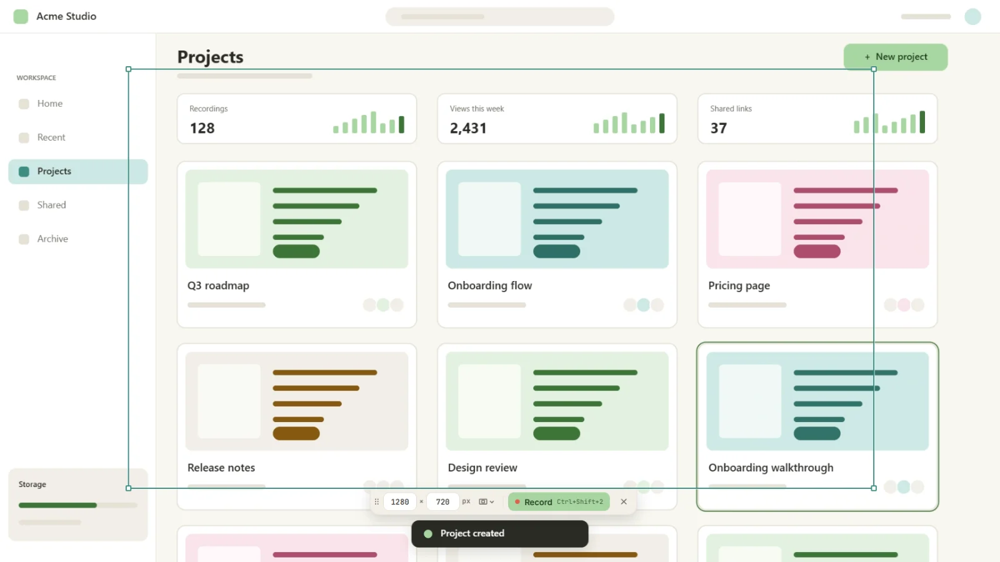
      </picture>
      <br><b>Seleccionar.</b> Un marco que mueves y redimensionas sobre la pantalla, con tamaños exactos en píxeles. Los clics fuera de él nunca generan zoom.
    </td>
    <td width="50%" valign="top">
      <picture>
        <source media="(prefers-color-scheme: dark)" srcset="docs/readme/welcome-tour-dark.webp">
        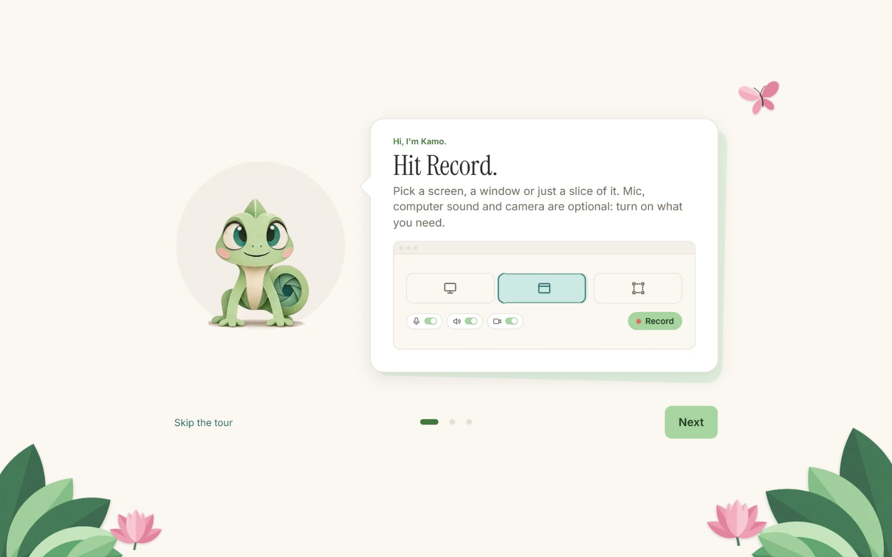
      </picture>
      <br><b>Tour de bienvenida.</b> Kamo te lo enseña en tres diapositivas, en tu idioma. Y luego se aparta.
    </td>
  </tr>
</table>

<p align="center">
  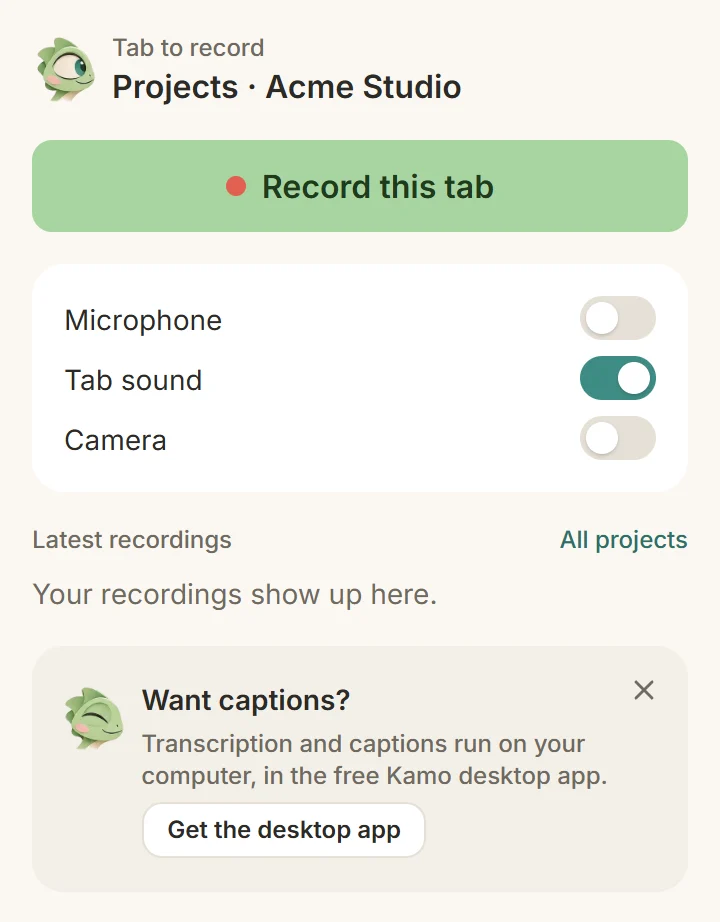
  <br><sub>La extensión para Chrome (muy pronto): un popup, un botón.</sub>
</p>

## ¿Escritorio o extensión?

El mismo motor, el mismo editor, la misma exportación. La diferencia está en lo que cada una puede grabar. Windows ya está disponible; la app para Mac y la extensión llegan muy pronto.

| | App de escritorio<br><sub>Windows · Mac (Apple silicon, pronto)</sub> | Extensión para Chrome (pronto)<br><sub>Chrome · Edge · Brave · Arc</sub> |
|---|:---:|:---:|
| Grabar la pantalla completa | ✅ | — |
| Grabar una ventana o una selección | ✅ | — |
| Grabar una pestaña del navegador | ✅ (como ventana) | ✅ |
| Micrófono | ✅ | ✅ |
| Sonido del equipo / sonido de la pestaña | ✅ | ✅ (sonido de la pestaña) |
| Burbuja de cámara web y 9:16 dividido | ✅ | ✅ |
| Zoom automático, cámara con resorte, cursor suave, línea de tiempo | ✅ | ✅ |
| Fondos prediseñados y colores sólidos | ✅ | ✅ |
| Tu propia imagen de fondo | ✅ | todavía no |
| Transcripción local y subtítulos | ✅ | — (solo escritorio) |
| Exportar MP4 y GIF en 16:9, 1:1, 9:16 | ✅ | ✅ |
| Exportación en 4K y 60fps | ✅ | — (las pestañas graban hasta 1080p30) |
| Dónde viven los proyectos | Una carpeta en tu disco | Dentro del navegador (OPFS) |
| Legible por el servidor MCP local | ✅ | — |

## Privado por diseño

- **100% local.** Grabar, editar y exportar funcionan sin conexión y sin cuenta.
- **Sin telemetría. Sin analíticas.** Ni "anonimizadas". Nada.
- **Nada sale de tu equipo a menos que tú decidas enviarlo.**
- **Solo el ratón, nunca el teclado.** Kamo registra clics y movimiento. No captura pulsaciones de teclas, y la extensión nunca lee la página que grabas. El CI lo comprueba en cada pull request.
- **Descarga ligera.** La app graba, edita y exporta. Lo pesado, como el modelo de transcripción, va en paquetes opcionales que se descargan solo cuando los pides.
- **No destructivo.** Tu grabación original nunca se altera; cada edición vive en `project.json`.

## Usa tus grabaciones con IA

Kamo incluye un pequeño **servidor MCP local** para que Claude Code (o cualquier cliente MCP) pueda conversar con lo que grabaste: transcripciones, la línea de tiempo de clics, los zooms y una captura de referencia cada 5 segundos.

> "Encuentra la grabación en la que expliqué la configuración de facturación y escribe una guía paso a paso a partir de ella."

Es **de solo lectura y no tiene acceso a la red**: lee tu carpeta de proyectos y responde al agente que conectaste. Nada más.

```bash
# Once @kamo/mcp is on npm (coming soon):
claude mcp add kamo -- npx -y @kamo/mcp --dir "<projects folder>"

# Today, from a clone of this repository:
pnpm install && pnpm --filter @kamo/mcp build
claude mcp add kamo -- node "<path to kamo>/apps/mcp/dist/cli.js" --dir "<projects folder>"
```

La app de escritorio muestra el comando exacto, con tu carpeta ya rellenada, en **Ajustes → Conectar con un agente**. Herramientas, ejemplos y otros clientes: [apps/mcp/README.md](apps/mcp/README.md) (en inglés).

## Compilar desde el código

Necesitas Node 24+ y pnpm (`npm i -g pnpm`).

```bash
pnpm install
pnpm --filter @kamo/desktop dev       # the desktop app
pnpm --filter @kamo/extension build   # the extension: load apps/extension/dist in chrome://extensions
pnpm --filter @kamo/mcp dev           # the local MCP server (try it with the MCP Inspector)
pnpm check                            # lint, typecheck, tests, i18n and the keyboard guard
```

Para grabar en el escritorio hace falta el asistente nativo de captura: Rust y Visual Studio Build Tools en Windows, Xcode en Mac. Consulta [`apps/desktop/native`](apps/desktop/native). ¿No tienes nada listo para grabar? [`apps/desktop/scripts/sample-project`](apps/desktop/scripts/sample-project) crea un proyecto de ejemplo realista que puedes abrir en el editor (es la demo "Acme Studio" de los clips de arriba).

## Arquitectura

<picture>
  <source media="(prefers-color-scheme: dark)" srcset="docs/readme/architecture-dark.svg">
  
</picture>

Un monorepo con pnpm, TypeScript en todas partes.

- **`packages/core`** es el motor: formato del proyecto, generación de zooms, cámara virtual, cursor suave, renderizado de fotogramas y exportación con WebCodecs (MP4 y GIF). La vista previa y la exportación ejecutan el mismo código.
- **`packages/ui`** es el editor, la línea de tiempo y los paneles (React).
- Ninguno de los dos sabe dónde se ejecuta: nada de Electron, Node ni `chrome.*` dentro de ellos. La captura, los eventos, el almacenamiento y los archivos entran por interfaces, así que la extensión reutiliza ambos tal cual.
- **`apps/desktop`** es Electron, con pequeños asistentes nativos de captura: Rust (Windows Graphics Capture) y Swift (ScreenCaptureKit).
- **`apps/extension`** es Manifest V3: captura de pestañas en un documento offscreen, un content script que solo mira el ratón y proyectos en OPFS.
- **`apps/mcp`** es el servidor MCP local: stdio, solo lectura, sin red.

¿Recién llegado, humano o agente? Empieza por [AGENTS.md](AGENTS.md). Te lleva a la documentación del producto, las decisiones y el plan en [docs/](docs/). La interfaz sigue [DESIGN.md](DESIGN.md). Estos documentos están en inglés.

## Idiomas

English, Português (Brasil), Español, 简体中文, 日本語, Deutsch, Français y 한국어, elegido según tu sistema y con cambio en cualquier momento. Fechas, números y duraciones se muestran con el formato de tu idioma. Hablantes nativos: revisar las traducciones es una de las contribuciones más útiles.

## Hoja de ruta

El plan paso a paso está en [docs/plan.md](docs/plan.md), y cada función con sus criterios de aceptación en [docs/features.md](docs/features.md). Lo siguiente: una versión para Mac probada, instaladores firmados, la ficha en la Chrome Web Store y `@kamo/mcp` en npm. Hay planes para una nube opcional para compartir enlaces; la app en sí sigue siendo gratis y completa.

## Cómo contribuir

Los issues y los pull requests son bienvenidos. Lee primero [CONTRIBUTING.md](CONTRIBUTING.md); explica las pocas reglas que el proyecto mantiene con firmeza (motor independiente de la plataforma, solo el ratón, todo texto traducido). Al participar, aceptas el [Código de Conducta](CODE_OF_CONDUCT.md). ¿Encontraste un problema de seguridad? Sigue [SECURITY.md](SECURITY.md) en lugar de abrir un issue público.

## Licencia

[MIT](LICENSE). Úsalo, haz un fork, publícalo.

## Agradecimientos

Kamo se apoya en grandes proyectos de código abierto: Electron, React, Vite, Tailwind CSS, mediabunny, gifenc, el MCP TypeScript SDK, whisper.cpp (en el paquete opcional de transcripción) y las tipografías Inter, Instrument Serif y JetBrains Mono. Los avisos de licencia de lo que va dentro de la app están en [THIRD_PARTY_NOTICES](THIRD_PARTY_NOTICES).

<p align="center">
  
  <br><sub>Hecho con paciencia de camaleón. Ahora ve a grabar algo.</sub>
</p>
