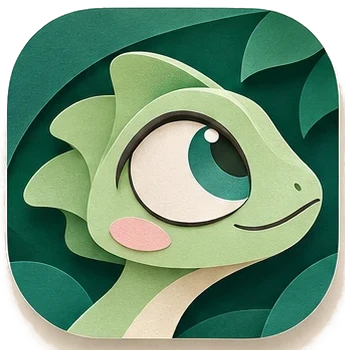

  

# Kamo 0.1.0 — the first take

**Hit record. Click. Stop. It's already edited.**

Kamo is a free, open source screen recorder that zooms in on every click, smooths your cursor and exports a video that looks like someone spent an hour editing it. Everything runs on your computer: no account, no telemetry, nothing leaves your machine unless you send it.

This is the first public release, for **Windows**. The **Mac app** and the **Chrome extension** are coming soon.

## Download

| | |
|---|---|
| **Windows 10 (2004+) and 11, 64-bit** | `Kamo-0.1.0-win-x64-setup.exe` below |
| **Mac** | coming soon |
| **Chrome extension** | coming soon |

> **First launch on Windows.** The installer isn't code-signed yet, so SmartScreen may say *"Windows protected your PC"*. Click **More info → Run anyway**. After that, Kamo updates itself: new versions download in the background and install when you restart, never in the middle of a recording.

## What's in it

### Record
- The **whole screen, a window or a selection** you draw and resize on screen.
- **Microphone, computer sound and webcam**, each optional and in sync with the video. 30 or 60 fps.
- A floating bar and a tray icon to pause and stop; a global shortcut (Ctrl+Shift+2) to stop from anywhere.
- Kamo only listens to the **mouse**. It never captures the keyboard.
- If Kamo or Windows crashes mid-recording, the take is recovered next time, audio and camera included.

### Edit
- **Automatic zoom on every click**, with a spring camera that eases in and out. Every zoom is a block on the timeline you can move, resize, change or delete; your own zooms are never overwritten.
- **Smooth cursor** with a click effect, or hidden.
- **Webcam bubble** in any corner or wherever you drag it, round, square, 16:9 or 9:16; it shrinks while the camera zooms. In 9:16 it can become its own card under the screen.
- **Styles**: wallpapers, your own image, padding, corners, shadow.
- **16:9, 1:1 and 9:16**, with the frame following your clicks in the crop formats.
- **Trim** the start and end; undo and redo everything.
- **Captions** from a local transcription, in 12 styles, editable on the timeline (see below).

### Export
- **MP4** in 1080p or 4K, at 30 or 60 fps, hardware-encoded where available.
- **GIF** up to 1280 px and 15 fps, with a size estimate before you export.
- Captions burned in, or as an **.srt** next to the video.
- No watermark. Ever.

### Organize and connect
- **Local playlists** on Home.
- **Transcription** with whisper.cpp, built into the app; the model (Light ~148 MB or Accurate ~488 MB) downloads from Hugging Face only when you ask, checked with SHA-256. It runs on your computer.
- **Local MCP server** so Claude Code (or another agent) can read your recordings: titles, transcripts, clicks and reference frames. Read-only, no network. Settings → *Connect to an agent* shows how.

### Everywhere
- English, Português (Brasil), Español, 简体中文 and 日本語.
- Light and dark themes, a welcome tour by Kamo, and "Copy diagnostics" for bug reports (you see the text before it goes anywhere).

## Known limitations
- **Windows only** in this release. The Mac app and the Chrome extension are built and tested in CI but not released yet.
- **Unsigned installer**: expect the SmartScreen prompt above.
- **Transcription models** download from Hugging Face (the official whisper.cpp models), only when you ask; Hugging Face is not reachable from mainland China yet.
- **`@kamo/mcp` isn't on npm yet.** Settings shows how to run the MCP server from a source checkout meanwhile.
- The translations were written with help from AI; corrections from native speakers are very welcome.

## Privacy
Kamo works fully offline. The only network requests it makes are the update check (the public release feed) and downloading a transcription model you asked for (from Hugging Face). No analytics, no telemetry, no account.

## Thanks
Kamo stands on great open source work: see [THIRD_PARTY_NOTICES](https://github.com/dssiqueira/kamo/blob/main/THIRD_PARTY_NOTICES). Found a bug or have an idea? [Open an issue](https://github.com/dssiqueira/kamo/issues) — *Settings → Copy diagnostics* helps a lot.
