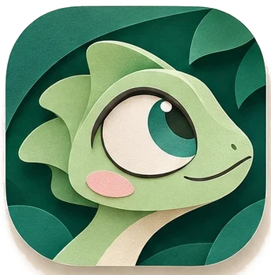

  

# Kamo 0.2.0 — eight languages, captions out of the box

**Hit record. Click. Stop. It's already edited.**

Kamo is a free, open source screen recorder that zooms in on every click, smooths your cursor and exports a video that looks like someone spent an hour editing it. Everything runs on your computer: no account, no telemetry, nothing leaves your machine unless you send it.

This release is for **Windows**. The **Mac app** and the **Chrome extension** are still coming soon.

## Highlights

- **Captions work out of the box.** The transcription program is now built into Kamo. The first time you create captions, pick **Light** (~148 MB) or **Accurate** (~488 MB) and the model downloads straight from Hugging Face, the official home of the whisper.cpp models. It is pinned to one version and checked with SHA-256, and no Kamo server is involved.
- **Deutsch, Français and 한국어.** Kamo now speaks eight languages, and transcribes German, French and Korean speech too.
- **MP4 and GIF in one export.** Check both formats and every aspect you picked comes out in each, with its own settings.
- **Start recording from anywhere.** The tray menu and the Windows taskbar jump list have *Start recording*: it records what you chose last on Home, with the countdown.

## Download

| | |
|---|---|
| **Windows 10 (2004+) and 11, 64-bit** | `Kamo-0.2.0-win-x64-setup.exe` below |
| **Mac** | coming soon |
| **Chrome extension** | coming soon |

> **Already on 0.1.0?** Kamo updates itself: the new version downloads in the background and installs when you restart, never in the middle of a recording.
>
> **First install on Windows.** The installer isn't code-signed yet, so SmartScreen may say *"Windows protected your PC"*. Click **More info → Run anyway**.

## What's new

### Record
- **Start recording** from the tray menu or the taskbar jump list, without opening Kamo first.
- A soft **tick on each number** of the 3-2-1 countdown. Don't like it? *Settings → Recording* turns it off.
- Recording **starts sooner** after the countdown: Kamo gets ready while it counts.
- Home's **microphone, computer sound and camera** are now three cards: a level meter for the mic, a live waveform for computer sound and a wide camera preview.
- A **Noise suppression** switch for the microphone, under *Audio settings* on Home. It stays on by default, as before; turn it off for music or if your voice sounds muffled.
- Choosing **Select** opens the selection frame right away.

### Edit and export
- The **editor opens as soon as a recording is saved**. If something went missing (audio, camera, a take cut short), Home tells you what happened and offers *Open in editor*.
- **MP4 and GIF in the same run**, each with its own settings.

### Captions
- A new **Transcribe** dialog: Light and Accurate side by side with their speed, accuracy and size, and one *Download and transcribe* button. The download shows its progress, the time left, Pause and Cancel, then the dialog follows your first transcript to "All set".
- If a download stops (offline, Hugging Face out of reach, a damaged file, a full disk), you get one clear message, and *Try again* picks up where it stopped.

### Settings and languages
- **German, French and Korean**, in the app and in the first-run language screen.
- Every Settings section has the same, calmer look: an illustrated header and cards.
- Long German and French labels, and Chinese, Japanese and Korean text, now fit their screens.
- *Connect to an agent* shows how to run the local MCP server from a source checkout, with your folders filled in.

### Fixes
- Some recordings had **small clicks in the microphone** track. The microphone is now recorded straight from the device.
- The microphone level **jumped while nobody spoke** on some headsets. Automatic gain and echo cancellation are now off.
- The permissions button says *Open Windows Settings* on Windows.
- On Windows, the menu no longer has a *Window* entry that only repeated the title bar buttons.

### Coming soon
- **Chrome extension:** while a tab records, a small bar in its own window shows the time and lets you pause and stop, and it is never part of the video. Clicking the Kamo icon stops the recording too.
- **Mac app:** *Start recording* is also in the Dock menu.
- Groundwork for a **Microsoft Store** package is in place. Kamo isn't in the Store yet.

## Known limitations
- **Windows only** in this release. The Mac app and the Chrome extension are built and tested in CI but not released yet.
- **Unsigned installer**: expect the SmartScreen prompt above.
- **Hugging Face can't be reached from mainland China**, so transcription models can't be downloaded there yet.
- **`@kamo/mcp` isn't on npm yet.** Settings shows how to run the MCP server from a source checkout meanwhile.
- The **new languages (German, French, Korean)** were written with help from AI and still need a review by native speakers, like the other translations. Corrections are very welcome.

## Privacy
Kamo works fully offline. The only network requests it makes are the update check (the public release feed) and, when you ask for captions, downloading the transcription model from Hugging Face. No analytics, no telemetry, no account.

## Thanks
Kamo stands on great open source work: see [THIRD_PARTY_NOTICES](https://github.com/dssiqueira/kamo/blob/main/THIRD_PARTY_NOTICES). Found a bug or have an idea? [Open an issue](https://github.com/dssiqueira/kamo/issues) — *Settings → Copy diagnostics* helps a lot.
