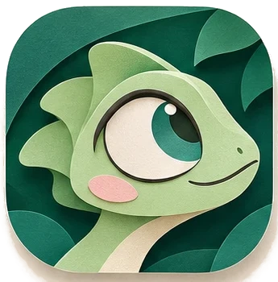

  

# Kamo 0.2.1 — now on Mac

**Hit record. Click. Stop. It's already edited.**

Kamo is a free, open source screen recorder that zooms in on every click, smooths your cursor and exports a video that looks like someone spent an hour editing it. Everything runs on your computer: no account, no telemetry, nothing leaves your machine unless you send it.

This release brings Kamo to **Mac** (Apple silicon) for the first time, next to **Windows**. The **Chrome extension** is still coming soon.

## Highlights

- **Kamo on Mac.** The same recorder, editor and export as on Windows, now on Macs with Apple silicon. Kamo asks only for Screen Recording (and the microphone when you turn it on); it follows your clicks without any extra permission and never reads the keyboard.
- **A clearer selection frame.** Resize marks on the corners and sides, and the recording bar stays outside the area you record.

## Download

| | |
|---|---|
| **Windows 10 (2004+) and 11, 64-bit** | `Kamo-0.2.1-win-x64-setup.exe` below |
| **Mac with Apple silicon (M1 or later), macOS 13.3+** | `Kamo-0.2.1-mac-arm64.dmg` below |
| **Chrome extension** | coming soon |

> **Already on Windows?** Kamo updates itself: the new version downloads in the background and installs when you restart, never in the middle of a recording.
>
> **First launch on Mac.** Open the dmg and drag Kamo into Applications. Kamo asks for **Screen Recording**: turn Kamo on in *System Settings → Privacy & Security → Screen & System Audio Recording*, then reopen it when macOS asks.
>
> **First install on Windows.** The installer isn't code-signed yet, so SmartScreen may say *"Windows protected your PC"*. Click **More info → Run anyway**.

## What's new

### Mac
- Record the **whole screen, a window or a selection**, with your microphone and the **computer's sound**, on Macs with Apple silicon.
- **No Input Monitoring.** Kamo reads only the mouse, which macOS allows without that permission, so the only thing it asks for is Screen Recording (and the microphone or camera when you turn them on).
- **Start recording** from the Dock menu; the menu bar icon shows while recording.
- An app icon in the shape macOS expects.

### Record
- The selection frame shows **resize marks** on its corners and the middle of each side, and while a selection records the recording bar stays **outside** it.

## Known limitations
- **Mac: Apple silicon only.** There is no build for Intel Macs. The Chrome extension is built and tested in CI but not released yet.
- **Unsigned Windows installer**: expect the SmartScreen prompt above. The Mac app is signed and notarized by Apple.
- **Hugging Face can't be reached from mainland China**, so transcription models can't be downloaded there yet.
- **`@kamo/mcp` isn't on npm yet.** Settings shows how to run the MCP server from a source checkout meanwhile.

## Privacy
Kamo works fully offline. The only network requests it makes are the update check (the public release feed) and, when you ask for captions, downloading the transcription model from Hugging Face. No analytics, no telemetry, no account.

## Thanks
Kamo stands on great open source work: see [THIRD_PARTY_NOTICES](https://github.com/dssiqueira/kamo/blob/main/THIRD_PARTY_NOTICES). Found a bug or have an idea? [Open an issue](https://github.com/dssiqueira/kamo/issues) — *Settings → Copy diagnostics* helps a lot.
